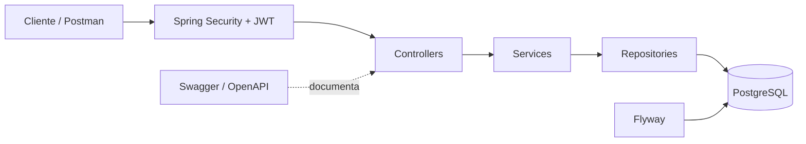
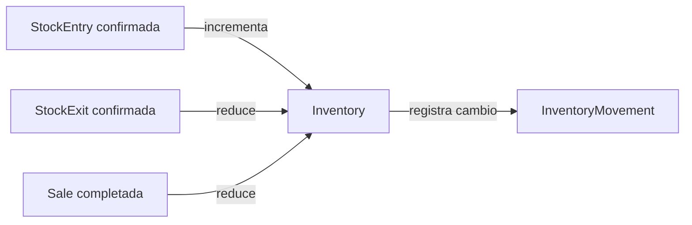

# StockFlow

StockFlow es una API REST para administrar catálogo, inventario y ventas con trazabilidad de movimientos. El proyecto está orientado a demostrar un backend transaccional, seguro y reproducible con Spring Boot y PostgreSQL.

La aplicación de portafolio está desplegada con el frontend en Vercel, esta API en Render y PostgreSQL administrado por Neon:

- Frontend: [stockflow-frontend-sigma.vercel.app](https://stockflow-frontend-sigma.vercel.app/login)
- API: [stockflow-api-fsul.onrender.com](https://stockflow-api-fsul.onrender.com)
- Health check: [stockflow-api-fsul.onrender.com/actuator/health](https://stockflow-api-fsul.onrender.com/actuator/health)

El servicio gratuito de Render puede suspenderse después de un periodo de inactividad y necesitar hasta unos 90 segundos para iniciar. Todos los nombres, productos, clientes y operaciones de la demo son ficticios. La interfaz presenta los importes en **USD** como convención de demostración; la API conserva los importes con `BigDecimal`, sin conversión de divisas ni soporte multimoneda.

## Problema que resuelve

Centraliza productos, proveedores, clientes y existencias; registra entradas y salidas; impide vender por encima del stock disponible y conserva un historial auditable de cada cambio de inventario.

## Funcionalidades principales

- Autenticación stateless con JWT y autorización por roles.
- Gestión de usuarios, categorías, productos, proveedores y clientes.
- Inventario por producto, entradas, salidas y ventas.
- Historial inmutable de movimientos de inventario.
- Reportes de low-stock, resumen de inventario y resumen de ventas.
- Paginación, filtros y ordenamiento en recursos de crecimiento continuo.
- Documentación interactiva OpenAPI/Swagger.
- Bootstrap explícito e idempotente del primer administrador.

## Tecnologías

- Java 21
- Spring Boot 4.1.1
- Spring MVC, Spring Security y JWT
- Spring Data JPA / Hibernate
- PostgreSQL 17 en Docker Compose
- Flyway
- Maven Wrapper
- Springdoc OpenAPI 3.1.0
- JUnit 5, Mockito y MockMvc
- Docker y GitHub Actions

## Arquitectura

El código usa organización *package-by-feature*. Cada módulo expone controladores HTTP, DTOs y mappers; los servicios contienen reglas de negocio y límites transaccionales; los repositorios aíslan JPA; y las entidades representan el modelo persistente. No se exponen entidades JPA directamente desde la API.



## Modelo de dominio

- Cada `Product` tiene un único `Inventory`.
- Una `StockEntry` confirmada incrementa existencias.
- Una `StockExit` confirmada reduce existencias.
- Una `Sale` completada reduce existencias y conserva el precio aplicado como snapshot.
- Cada cambio genera un `InventoryMovement` histórico.



## Seguridad

La API no mantiene sesiones de servidor. El login entrega un JWT que debe enviarse como `Authorization: Bearer <token>`.

| Rol | Responsabilidad principal |
|---|---|
| `ADMIN` | Administración completa y todos los reportes |
| `INVENTORY_MANAGER` | Catálogo, proveedores, inventario, entradas, salidas y reportes de inventario |
| `SELLER` | Clientes, ventas y resumen de ventas |

El login, Swagger y `/actuator/health` son públicos. El resto de la API exige autenticación y permisos específicos.

## Reglas de negocio importantes

- El stock nunca puede ser negativo.
- Una venta o salida no puede superar las existencias.
- Entradas, salidas y ventas críticas son transaccionales.
- Las filas de inventario se bloquean con `PESSIMISTIC_WRITE` y orden determinista por ID para evitar overselling y reducir deadlocks.
- Los movimientos históricos no tienen endpoints de escritura.
- Los borrados de catálogo y usuarios son desactivaciones lógicas.
- Los importes usan `BigDecimal`.

## Variables de entorno

| Variable | Obligatoria | Descripción |
|---|---:|---|
| `DB_URL` | Sí | URL JDBC de PostgreSQL |
| `DB_USERNAME` | Sí | Usuario de base de datos |
| `DB_PASSWORD` | Sí | Password de base de datos |
| `JWT_SECRET` | Sí | Secreto Base64 que decodifique al menos 32 bytes |
| `CORS_ALLOWED_ORIGINS` | No | Lista separada por comas de orígenes web permitidos; por defecto `http://localhost:5173,http://localhost:3000` |
| `STOCKFLOW_BOOTSTRAP_ADMIN_ENABLED` | No | Activa explícitamente el bootstrap; por defecto `false` |
| `STOCKFLOW_BOOTSTRAP_ADMIN_EMAIL` | Si se activa | Email del primer administrador |
| `STOCKFLOW_BOOTSTRAP_ADMIN_PASSWORD` | Si se activa | Password de al menos 8 caracteres; se almacena con BCrypt |
| `STOCKFLOW_BOOTSTRAP_ADMIN_FIRST_NAME` | Si se activa | Nombre |
| `STOCKFLOW_BOOTSTRAP_ADMIN_LAST_NAME` | Si se activa | Apellido |

Use [.env.example](.env.example) como referencia. Nunca versione un `.env` real.

### Primer administrador

En una base nueva, active temporalmente las variables `STOCKFLOW_BOOTSTRAP_ADMIN_*`. El arranque crea el usuario únicamente si todavía no existe un ADMIN ni el email configurado. Después del primer inicio exitoso, cambie `STOCKFLOW_BOOTSTRAP_ADMIN_ENABLED=false` y reinicie. La contraseña nunca se registra en logs.

## Ejecución local

1. Cree una base PostgreSQL llamada `stockflow_db`.
2. Configure las variables anteriores en su terminal.
3. Inicie la aplicación:

Windows:

```powershell
.\mvnw.cmd spring-boot:run
```

Linux/macOS:

```bash
./mvnw spring-boot:run
```

Flyway ejecutará V1 y V2 automáticamente.

## Ejecución con Docker

1. Copie `.env.example` a `.env` y reemplace todos los valores de ejemplo sensibles.
2. Para generar un secreto JWT válido puede usar `openssl rand -base64 32`.
3. Valide e inicie:

```bash
docker compose config
docker compose up --build -d
docker compose ps
```

La API queda disponible por defecto en `http://localhost:8080`. Para detenerla sin borrar los datos:

```bash
docker compose down
```

El volumen `stockflow_postgres_data` es persistente. No use `docker compose down -v` si desea conservar la base.

## Swagger y colección API

- Swagger UI: `http://localhost:8080/swagger-ui/index.html`
- OpenAPI JSON: `http://localhost:8080/v3/api-docs`
- Healthcheck: `http://localhost:8080/actuator/health`
- Colección Postman: [`docs/postman/StockFlow.postman_collection.json`](docs/postman/StockFlow.postman_collection.json)

La colección guarda automáticamente el JWT recibido por login en la variable `token`.

## Frontend y entorno full-stack

- Repositorio frontend: [Mateo1744/stockflow-frontend](https://github.com/Mateo1744/stockflow-frontend)
- Compose integrado: `compose.full-stack.yml` en el repositorio frontend (los repositorios deben permanecer como carpetas hermanas).
- Datos controlados: [`docs/demo-setup.md`](docs/demo-setup.md).

CORS se configura mediante `CORS_ALLOWED_ORIGINS`; no usa comodines ni credenciales de navegador. Para Docker local use `http://localhost:3000`. `VITE_API_URL` debe ser `http://localhost:8080`, porque se resuelve durante el build y luego lo utiliza el navegador del host.

## Tests y build

```powershell
.\mvnw.cmd test
.\mvnw.cmd clean package
```

La suite actual contiene **288 tests** unitarios y de integración. GitHub Actions ejecuta la misma suite con Java 21 y un PostgreSQL aislado en cada `push` y `pull_request`.

## Migraciones

- `V1__create_initial_schema.sql`: esquema inicial, restricciones e índices.
- `V2__seed_system_roles.sql`: roles `ADMIN`, `INVENTORY_MANAGER` y `SELLER`.

No se insertan usuarios, passwords ni datos demo mediante Flyway.

## Endpoints principales

| Área | Base |
|---|---|
| Autenticación | `/api/auth` |
| Usuarios | `/api/users` |
| Categorías | `/api/categories` |
| Productos | `/api/products` |
| Proveedores | `/api/suppliers` |
| Clientes | `/api/customers` |
| Inventario | `/api/inventory` |
| Entradas / salidas | `/api/stock-entries`, `/api/stock-exits` |
| Ventas | `/api/sales` |
| Movimientos | `/api/inventory-movements` |
| Reportes | `/api/reports` |

Swagger contiene parámetros, filtros y esquemas detallados.

## Decisiones técnicas

- **DTOs y mappers:** evitan acoplar el contrato HTTP a entidades JPA.
- **BigDecimal:** conserva precisión en precios, costos e ingresos.
- **Flyway:** hace reproducible y auditable el esquema.
- **JWT stateless:** simplifica la autorización de una API REST.
- **Soft delete:** protege referencias e históricos.
- **Pessimistic locking:** serializa modificaciones concurrentes del mismo inventario.
- **Límites transaccionales:** mantienen validación, stock y movimientos en una sola unidad atómica.

## Mejoras futuras

- Refresh tokens y cambio/restablecimiento de contraseña.
- Observabilidad, métricas y alertas operativas.
- Automatización adicional de despliegues y pruebas end-to-end aisladas.
- Reportes analíticos avanzados.
